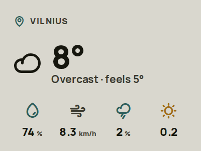

<h1 align="center">ZecTrix NOTE4C Devkit × Tesserae</h1>

  Your photos and widgets on a four-colour e-paper frame.

  <strong>Firmware 1.2.1</strong> · ESP-IDF 6.1 · Local REST · Cloud · Relay

  

  <a href="https://note4ctesserae.pages.dev"><strong>Install firmware</strong></a> ·
  <a href="#install-and-set-up">Setup guide</a> ·
  <a href="#buttons-and-led">Buttons and LED</a> ·
  <a href="CHANGELOG.md">Changelog</a>

> [!WARNING]
> **For the ZecTrix NOTE4C Devkit with the four-colour display only! Do not flash this firmware onto the grayscale NOTE4 variant.**

Display pictures from [Tesserae](https://github.com/dmellok/tesserae) Cloud or your own Tesserae server on the **ZecTrix NOTE4C Devkit**. Configure Wi-Fi and your server from a phone, then let the device check for pictures on its schedule.

Display operation, fast refresh, charging indication and normal sleep/wake cycles have been tested on hardware. Button responsiveness after the 1.2.1 fix and a normal Front wake/check/sleep cycle are confirmed; broader recovery testing and battery characterization remain open. See [CHANGELOG.md](CHANGELOG.md).

## What it does

- Downloads pictures over Wi-Fi and skips repainting when the image is unchanged.
- Sleeps between scheduled checks, with buttons for an immediate check or server action. After three failed connection attempts on separate wakes, it waits at least one hour before retrying; longer saved intervals are preserved.
- Provides a phone-friendly setup page and built-in setup, registration, waiting, Unpaired and low-battery screens.
- Offers Native, 5-second and 10-second refresh choices. Native is the default; faster modes can produce less saturated colours.
- Reports battery level, signal strength and status. REST also supports requested diagnostic log uploads.
- Shows charging status on the LED, including brief charger-event wakes while sleeping.

## Before you start

- **ZecTrix NOTE4C Devkit**, ESP32-S3 with 16 MB flash, 8 MB PSRAM and the 400 × 300 four-colour panel. This firmware is not for the grayscale NOTE4.
- A USB-C **data** cable and a computer for flashing.
- A password-protected 2.4 GHz Wi-Fi network and either Tesserae Cloud or a reachable Tesserae server with Note4c device support installed.
- **A verified backup is strongly recommended before the first installation, but is optional.** Keep it private: it can contain credentials and device-specific settings.

## Install and set up

**The easiest and recommended method is the web installer: [https://note4ctesserae.pages.dev](https://note4ctesserae.pages.dev).** Open it in desktop **Chrome or Edge**. Web installation does not require Python, command-line tools or downloading firmware files yourself.

1. **Back up your device (strongly recommended, optional).** A verified backup gives you a way to restore the original firmware. Follow the [backup and verification instructions](FLASHING.md#2-back-up-and-verify-before-flashing), and keep the backup safe and private. The website does not create a backup automatically. If you choose to skip it, continue to step 2.
2. **Install using the website.** Check the displayed firmware version, connect a USB-C data cable and close other serial monitors. Click **Connect device** and select your Note4c. If your device does not appear, try holding the **Front button** until the USB device appears, then release it and select the device. Choose **Fresh install** for the first installation, or **Update** to keep settings on a compatible installation, then click the install button. Keep USB connected until verification completes and the installer requests a restart. If the device does not start, release the Front button and reconnect USB or press **RESET**. See the [web flashing guide](FLASHING.md#flash-using-the-website) for more details.
3. **For a fresh installation, join the setup network** shown on the display: `Note4c-Setup-XXXX`, password `tesserae`. If setup does not open automatically, visit **http://192.168.4.1**.
4. **Enter Wi-Fi details**, choose Local REST, Cloud or Relay, complete its connection details and choose a refresh mode, then press **Save & restart**. For an existing network, leaving its password blank keeps the saved password.
5. **For Local REST**, enter the server URL and optional Device ID, then register in Tesserae under **Settings → Devices** or enter a six-digit pairing code. **For Cloud**, enter the eight-digit claim code from **Settings → Panels → Add a panel** and optionally choose a Device ID; the Cloud URL is fixed in firmware. **For Relay**, enter the HTTPS relay address and the pairing code created by your own server. For a local server, use **ZecTrix NOTE4C Devkit** and **Nominal BWRY**. Send an image or assign a lineup and schedule.

**Alternative: manual flashing.** If you prefer command-line tools, download the 1.2.1 assets from [GitHub Releases](https://github.com/varanu5/zectrix-note4c-devkit-tesserae-client/releases) and follow the [manual flashing guide](FLASHING.md#flash-manually).

## Connections and updates

Local REST, Cloud and Relay each retain their own saved connection details, credentials and server sleep intervals. A blank code keeps the selected connection's existing pairing when its endpoint and ID are unchanged, including when switching back from another mode. Changing only Wi-Fi or refresh mode does not require another code. New endpoints, changed IDs or an explicitly entered new code start pairing again. Wi-Fi and display refresh mode are shared.

The setup header shows the saved device ID, connection, endpoint, firmware version and setup IP. Successful HTTPS connections log `TLS certificate verified` in the serial monitor; certificate and hostname verification remain enabled.

Relay receives authenticated, encrypted images and settings. All three modes use the same **Unpaired** instruction screen after confirmed removal and sleep for 24 hours. REST/Cloud first attempt credential recovery and only mark a previously paired device unpaired when discovery confirms it is unregistered. Temporary network errors do not trigger this screen. REST/Cloud retry discovery on later wakes; Relay requires a new pairing code. Press Front to wake sooner or hold it for 20 seconds to open setup. Low-battery protection still takes priority, and opening setup does not erase saved profiles.

Updates preserve saved connection profiles. Older firmware may already have overwritten inactive connections; enter those once to save them separately. Downgrading to firmware predating independent profiles reads the pre-upgrade settings snapshot, not later profile edits; upgrading again resumes the saved profiles.

Relay navigation and refresh actions wait up to 45 seconds, checking every five seconds and stopping early when a new image arrives. Normal scheduled checks have no additional wait. MQTT, Bluetooth and Wi-Fi firmware updates are not implemented yet.

## Buttons and LED

| Control | Action |
| --- | --- |
| Front: short press | Wake and check for a new image; unchanged images are not repainted |
| Front: hold 5–10 seconds, then release during the steady LED cue | Ask the server for a fresh render and repaint its response |
| Front: hold 20 seconds, then release at the three-flash cue | Open setup |
| Lower side button | Wake and send the server's `right` action |
| Upper side button | Unused |

Front and lower-button actions receive a brief LED acknowledgement; scheduled checks do not. The LED stays on while charging and turns off when charging stops, according to the charger hardware rather than the estimated battery percentage.

Each wake handles one action. Additional presses during network or display work are not queued. If Front or Down remains held when the operation finishes, the device waits for release, using light sleep for prolonged holds, then enters deep sleep with both buttons enabled for wake-up.

## License and credits

Created by **[varanu5](https://github.com/varanu5)** as a hobby project for my own needs, and shared with the community in the hope that others find it useful. Please use the firmware at your own risk. I cannot take responsibility for damaged or bricked devices, or lost data.

Thanks to the Tesserae project and the firmware, display, font, QR-library etc. [THIRD_PARTY_NOTICES.md](THIRD_PARTY_NOTICES.md).

Licensed under **AGPL-3.0-or-later**; see [LICENSE](LICENSE). Third-party components retain their own licenses and notices.
